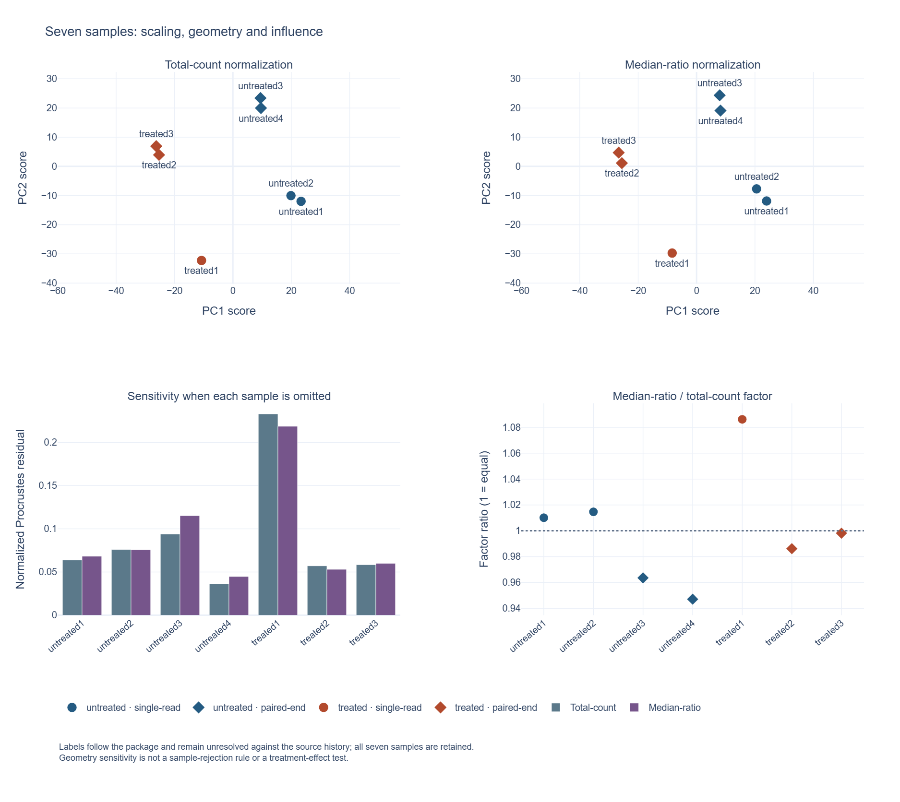

# Pasilla expression QC

This project checks sample labels, count totals, and sensitivity to transformation choices in public *Drosophila melanogaster* (fruit fly) RNA-sequencing (RNA-seq) data. RNA-seq samples RNA-derived material; these gene counts record assignments to genes, not absolute numbers of molecules.

**[Start here: project background, purpose, and key themes](docs/project-context.md).** For more detail, read **[the biology and analysis concepts](docs/biology-and-concepts.md)**.

**Status: working educational analysis, version 0.3.0.** The inputs are real public data; this is a descriptive reanalysis, not a new biological finding or a reproduction of the original splicing study. It runs locally without downloading data after the Python dependencies are installed.

## Why this project

Before fitting an expression model, check which samples and transformations you are comparing. This project shows how those choices affect the sample summaries.

The `pasilla` Bioconductor package provides counts derived from the experiment described by [Brooks et al. (2011)](docs/references.md#brooks-2011). Its annotation has three treated and four untreated samples, including single-read and paired-end libraries. The count table and original annotation are bundled unchanged, together with the upstream package description and a manifest of SHA-256 fingerprints (identifiers calculated from exact file bytes). [Provenance and license details](data/README.md) explain the pinned source snapshot.

The program verifies those files before analysis. It is designed for this example. Other datasets need a separate manifest, an appropriate metadata mapping, and a scientific review of the analysis choices.

## What it does

- Validate the count matrix and align the sample annotation by identifier rather than row order.
- Compare count-table totals, zero fractions, and numbers of detected genes across samples.
- Inspect counts for each condition/read-type combination and the rank (number of independent columns) of an additive design matrix that encodes the annotations.
- View sample principal component analysis (PCA), a summary of major directions of variation, on $`\log_2(\mathrm{CPM}+1)`$. CPM means counts per million supplied assignments; color marks condition and shape marks read type.
- Compare that view with PCA on $`\log_2(\text{count}+1)`$, using the same genes in both analyses.
- Compare total-count and median-ratio normalization with the same reference depth and logarithm offset, then inspect the resulting sample distances and correlations.
- Refit both normalized PCA views after leaving out each sample, and quantify how much the remaining sample geometry changes.
- Inspect numeric outputs, input fingerprints, and the exact analysis settings.

The Python scripts independently implement normalization formulas and matrix transformations, compute PCA using singular value decomposition (SVD), and plot changes in sample geometry. Input checks and tests help readers reproduce the calculations and trace failures. The analysis does not run DESeq2, estimate gene-level differential expression, or test alternative splicing. [Methods and limitations](docs/methods.md) give the formulas; [source notes](docs/source-notes.md) distinguish the original literature, current software documentation, and this implementation.

The separate `audit_results.py` command checks completeness, source fingerprints, sample labels, and byte-level consistency of a result package. It does not rerun the statistics or resolve source-label uncertainty.

## Quick start

Use Python 3.12. From this repository's root:

```sh
python -m venv .venv
# macOS/Linux:
source .venv/bin/activate
# Windows PowerShell instead: .venv\Scripts\Activate.ps1
python -m pip install -r requirements.txt
python -m unittest discover -s tests -v
python analysis.py --out my-results
```

The last command writes `my-results/`, preserving the included example outputs in `results/`. Keep output folders separate from the input folder. The GitHub Actions workflow defines continuous integration (CI) checks; consult a hosted run to see whether those checks passed.

Check the committed result package with:

```sh
python audit_results.py verify --manifest audits/example-artifacts.json
```

### Compare a numerical rerun

For a numerical rerun comparison, keep the original directory intact:

```sh
python analysis.py --out my-results
python compare_results.py results my-results --report my-comparison.json
```

The comparator reports exact schema/identity mismatches and finite numeric differences beyond the declared tolerance. Exit status 0 means agreement, 1 means differences, and 2 means an invalid invocation or report-writing error.

## Example results

[Read the example report](results/report.md), or open the [sample QC table](results/sample_qc.csv) and [machine-readable summary](results/summary.json).


The analysis begins with 14,599 genes and seven samples. It retains 8,148 genes with at least 10 counts in at least three samples for every PCA view. Count-table totals and zero fractions use all genes. These are declared exploratory settings, not universal thresholds for accepting an experiment.

The normalization comparison estimates relative scale in two ways: from each sample's total counts, and from median log ratios across the 9,063 genes positive in every sample. Both use a reference depth of about 12.46 million counts before applying $`\log_2(\text{normalized count}+1)`$. That common scale matters: changing the overall count scale while keeping a $`+1`$ offset can itself change low-count relationships.

In the included run, median-ratio/total-count size-factor ratios range from **0.947 to 1.086**. The two-dimensional PCA configurations have a normalized Procrustes residual of **0.0548**: the remaining shape difference after aligning position, scale, rotation, and reflection. These numbers describe sensitivity; they do not identify a winning normalization method.


Omitting `treated1` produces the largest change in the two-dimensional configuration under both normalizations (residuals **0.2330** and **0.2187**, respectively). That is a reason to understand its influence, not a reason to discard it. With only seven samples, this exercise cannot distinguish experimental heterogeneity from a sample-quality problem. See the [full report](results/report.md) for every omission and the [methods](docs/methods.md) for what is held fixed.

PCA summarizes the chosen transformed matrices. Clusters and separation do not establish statistical significance or identify whether condition, library preparation, or another factor caused a pattern. The plots label read type because it differs among samples. The analysis retains every sample regardless of its position on a plot.

### Follow a sample across the summaries



The [sample explorer](docs/sample-explorer.md) links those summaries through hover details and consistent condition/read-type labels. It reads the saved tables, checks identity alignment and complete omissions, and leaves the audited result package unchanged. `treated1` remains the only treated single-read sample; its influence does not justify automatic removal or resolve the source-label discrepancy.

## Practical use and limitations

Use the [practical-use guide](docs/practical-use.md) to create and verify a snapshot for a new result directory. Matching bytes alone does not establish numerical reproducibility or biological validity.

Sample-label provenance remains unresolved. The [source follow-up](docs/review-2026-10-21.md#source-reconciliation) found archive metadata supporting the package's allocation, but the article text differs and the exact mapping to the derived count columns remains unaudited. This project retains the package labels and makes no differential-expression or splicing inference.

### Numerical comparison

The separate [numerical comparator](docs/practical-use.md) checks reruns without requiring identical PNG bytes. Its [example report](examples/numerical-comparison.json) records one local reproduction. Agreement with a reference does not establish biological correctness or resolve the annotation discrepancy.

## Documentation

| Guide | Purpose |
| --- | --- |
| [Project context](docs/project-context.md) | Background, rationale, and key themes |
| [Biology and concepts](docs/biology-and-concepts.md) | Counts, normalization, PCA, and interpretation |
| [Methods](docs/methods.md) | Exact calculations and design checks |
| [References](docs/references.md) / [source notes](docs/source-notes.md) | Complete bibliography and implementation attribution |
| [Glossary](docs/glossary.md) | Biological, statistical, and computing vocabulary |
| [Assumptions](docs/assumptions.md) | Rationale, checks, and consequences of material assumptions |
| [Reference audit](docs/reference-audit.json) | Source-by-source verification and access limits |
| [Scientific and editorial review](docs/review-2026-10-20.md) | Corrections, coverage, and verification results |
| [Maintenance and source review](docs/review-2026-10-21.md) | Current fixes, source checks, validation, and remaining limits |
| [Data provenance](data/README.md) | Pinned files, licenses, and unresolved labels |
| [Practical use](docs/practical-use.md) | Contracts, worked audit, and next improvements |
| [Literature review](docs/literature-review.md) | Bounded evidence review and implementation rationale |
| [Search log](docs/search-log.json) | Exact queries, counts, identifiers, and decisions |
| [Evidence update 02](docs/search-update-02.json) | Targeted same-day follow-up search and decisions |

## Development and reuse

Run `python -m unittest discover -s tests -v`. The scientific example remains version 0.3.0; the independent audit has schema version 1.0. Existing numeric and plot outputs are retained. See [contribution notes](CONTRIBUTING.md).

Complete scientific and software citations are in [References](docs/references.md). Original analysis code and documentation are MIT-licensed. The upstream data retain their original terms; see [data provenance](data/README.md).
