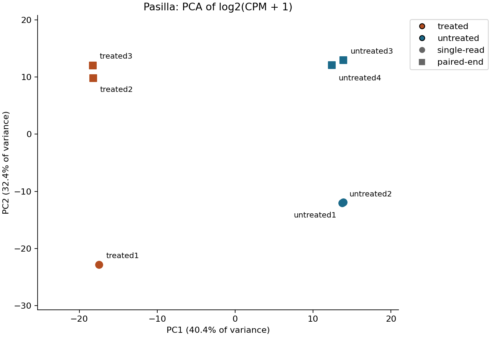
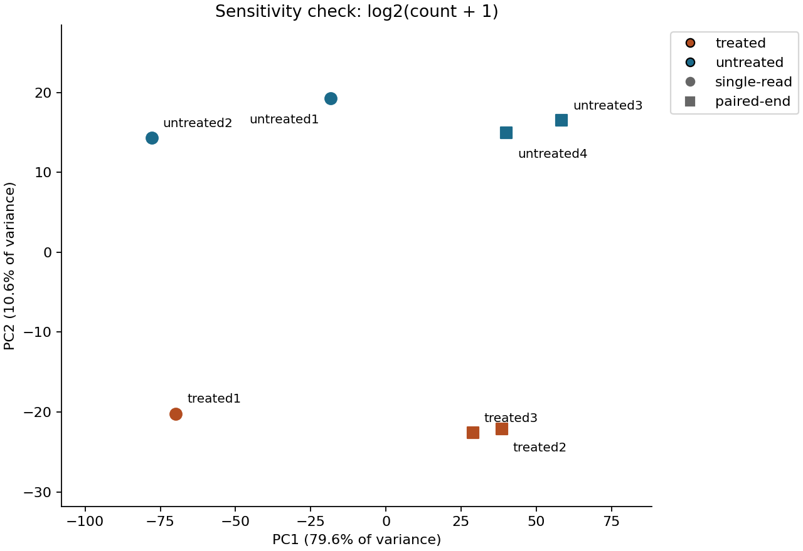
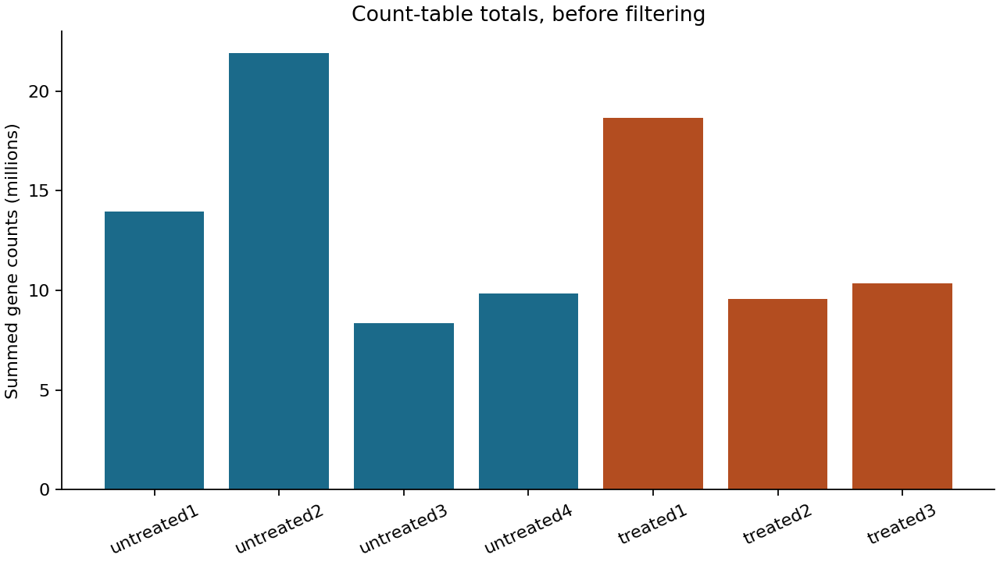
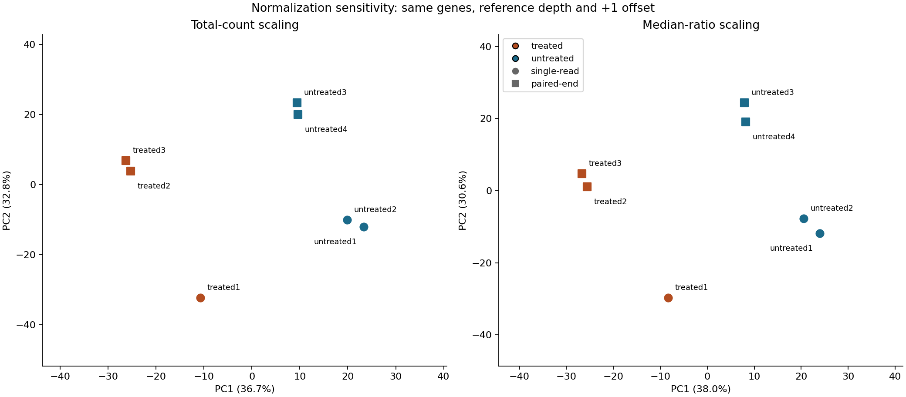
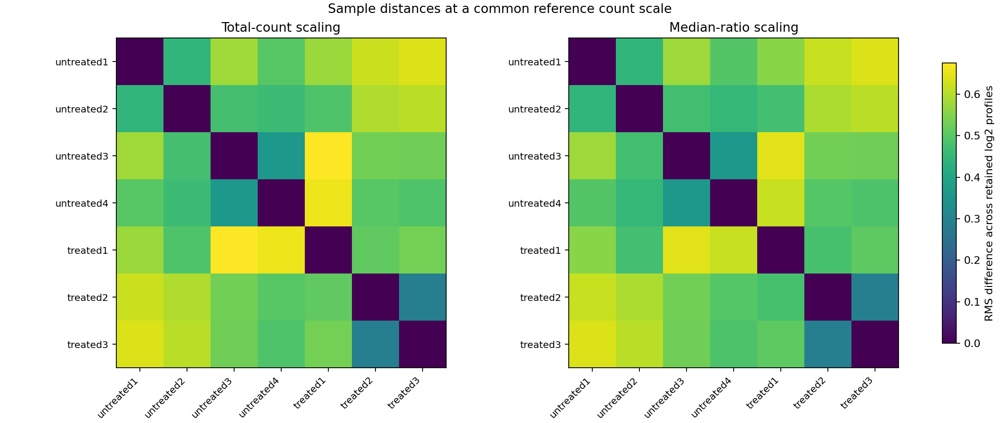
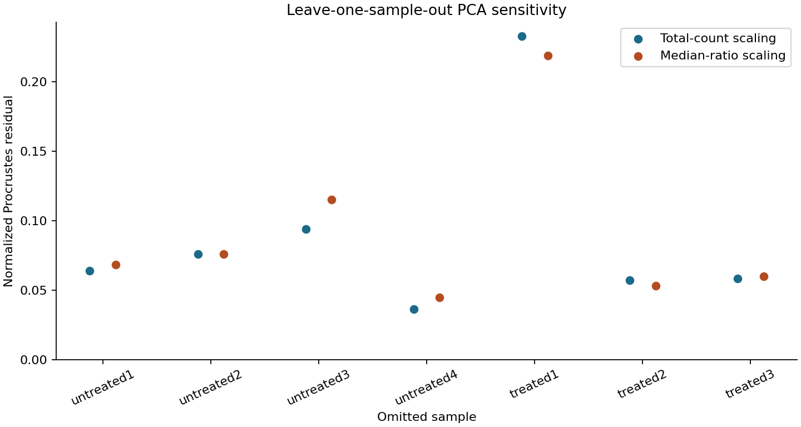

# Pasilla expression QC: example run

This run uses 14,599 genes and 7 samples from the pinned public count table. 8,148 genes pass the exploratory filter (at least 10 counts in at least 3 samples).

The log2(CPM + 1) PCA assigns 40.4% of variance to PC1 and 32.4% to PC2. The log2(count + 1) sensitivity analysis assigns 79.6% and 10.6%, respectively. These percentages describe two different transformed data matrices; they are not an accuracy comparison.

The plots display both condition and read type so potential technical structure is visible. They do not isolate the cause of sample separation or establish differential expression. No sample is dropped based on these plots.

Count-table totals sum the supplied gene counts. They are not the original total sequenced-read counts. The full numeric results are in `sample_qc.csv`, `sample_correlations.csv`, and `summary.json`.

## Normalization sensitivity with a shared count scale

The new comparison holds the retained genes, reference count depth (12,457,236.5), and +1 offset fixed. It contrasts total-count scaling with an independently implemented median-ratio calculation using 9,063 genes positive in all seven samples. The two factor vectors have geometric mean one. Their median-ratio/total-count factor ratios range from 0.947 to 1.086.

The normalized two-dimensional Procrustes residual between the views is 0.0548. Zero would mean identical plotted geometry after translation, overall scaling, rotation and reflection. There is no universal acceptance threshold, and neither close agreement nor disagreement establishes which normalization is biologically correct.

These distances summarize root-mean-square differences over the retained log2 gene profiles. They use all retained genes, rather than only the first two PCs. All samples remain included. The numeric distance and correlation matrices are provided separately for each method.

## How much does one sample influence the PCA picture?

The leave-one-out study refits normalization and PCA after each omission, while holding the original gene set and reference depth fixed. It compares the remaining samples with those same samples in the full-data two-dimensional picture.

For total-count scaling, residuals range from 0.0364 to 0.2330; the largest change follows omission of `treated1`. For median-ratio scaling, they range from 0.0448 to 0.2187; the largest change follows omission of `treated1`. An influential sample is not thereby an erroneous sample. These are descriptive refits, not cross-validation of a predictive model or evidence of causation.

See `normalization_factors.csv`, `leave_one_out_stability.csv`, and the [methods](../docs/methods.md) for exact definitions and limitations. The older CPM and raw-log views above use different overall count scales; the shared-scale comparison isolates normalization choice more carefully.
